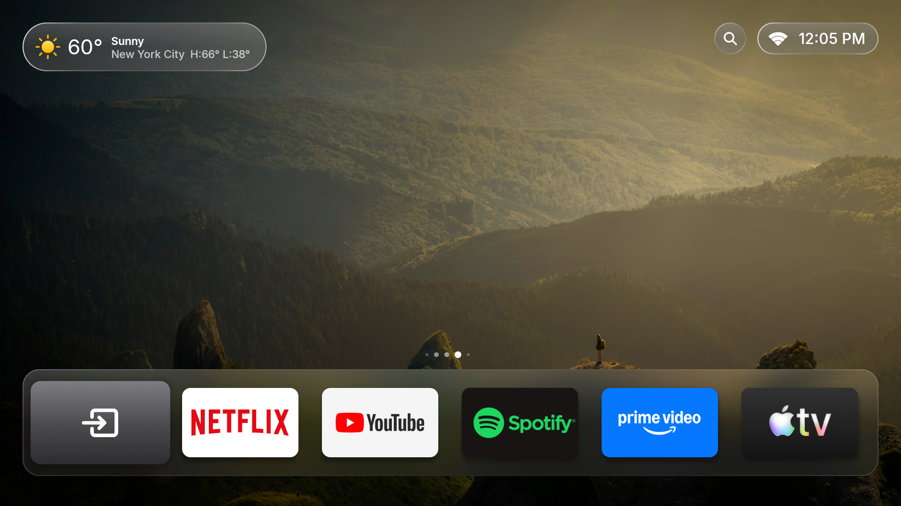
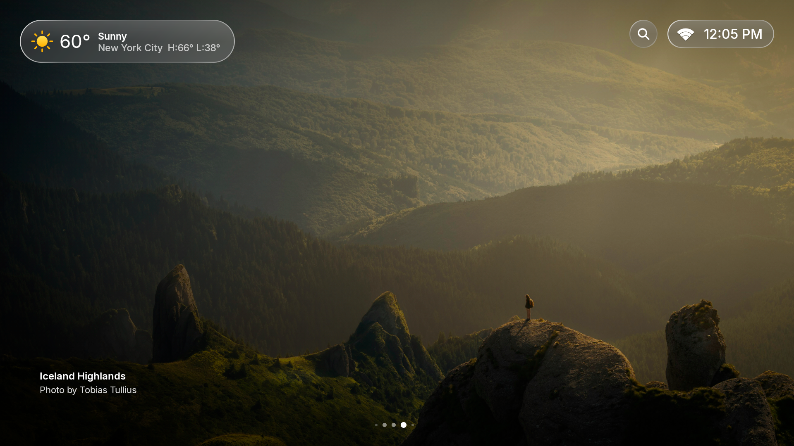
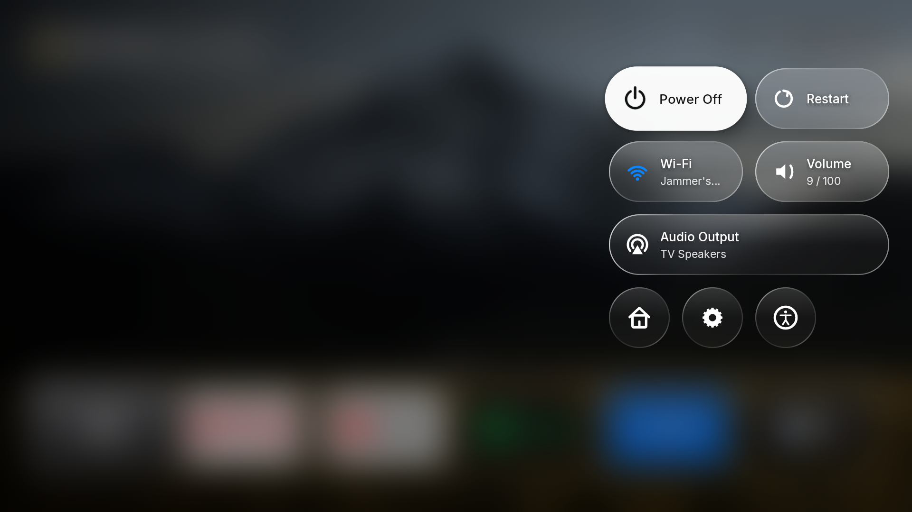
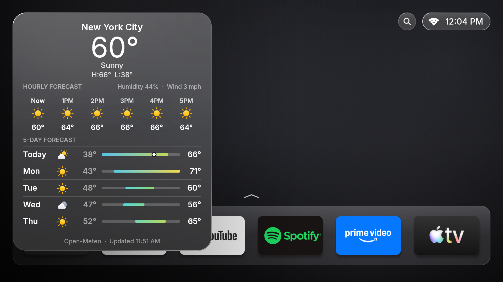
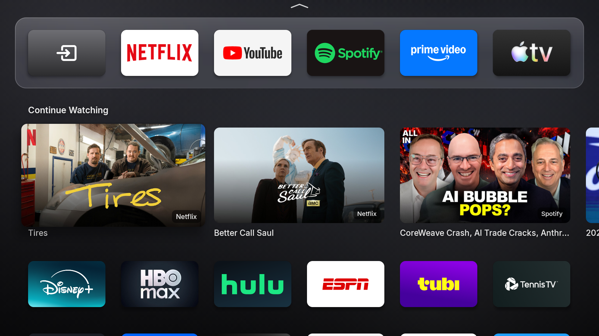
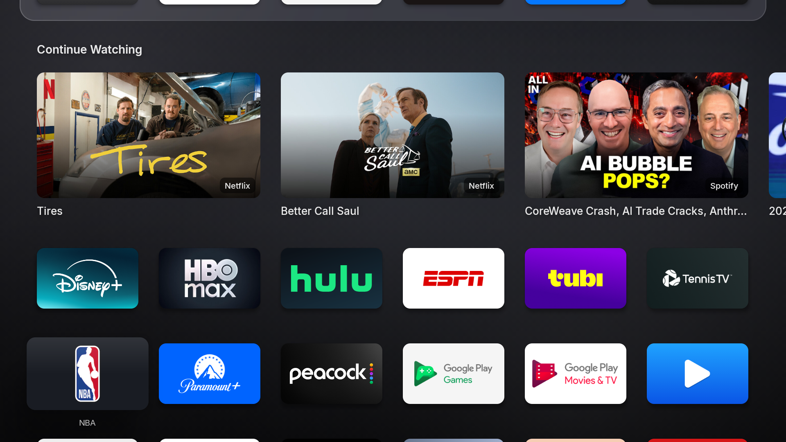

# Hume Launcher v2

A tvOS-inspired home screen for Android TV and Google TV, built on top of [Hume Launcher](https://github.com/petrobot-admin/hume-launcher) by Petrobot. Designed and customized for TCL Google TV (QM6K series) but works on any Android TV device.

---

## Screenshots

### Home — Dock View


### Hero Mode — Full-screen Wallpaper


### Control Center


### Weather


### Continue Watching + App Grid


### App Grid


---

## Features

- **50 bundled 4K landscape wallpapers** — shuffled on launch, auto-advances every 30 seconds. Location and photographer credited in hero mode.
- **tvOS-style dock** — frosted glass, app icons with glare animation on focus. Light/dark glare automatically selected based on icon background.
- **Continue Watching row** — populated from the system TV provider (Netflix, Prime Video, etc.) with app badge and thumbnail.
- **Live weather widget** — current conditions, hourly and 5-day forecast via Open-Meteo.
- **Control Center** — Power Off, Restart, Wi-Fi, Volume, Audio Output, and shortcuts to Hume Settings, TV Settings, and Accessibility.
- **Home button override** — AccessibilityService intercepts the Home key on Google TV so it always opens Hume instead of the stock launcher.
- **State restoration** — returns to the exact app you were focused on when pressing Home from another app.
- **Liquid Glass UI** — adaptive frosted glass on the dock, weather card, search, and time/control chip.

---

## Requirements

- Android TV or Google TV device (tested on TCL 65" QM6K)
- ADB enabled (Developer Options → Network Debugging)
- macOS/Linux build machine with:
  - JDK 17+ (`brew install openjdk@17`)
  - Android SDK build-tools 34.0.0 and platform android-34:
    ```bash
    brew install android-commandlinetools
    sdkmanager "build-tools;34.0.0" "platforms;android-34"
    ```

---

## Installation

### 1. Clone

```bash
git clone https://github.com/AdrianTong/hume-launcher-v2.git
cd hume-launcher-v2
```

### 2. Connect your TV via ADB

Enable **Developer Options → Network Debugging** on your TV, then pair:

```bash
adb pair <tv-ip>:<pair-port>
adb connect <tv-ip>:<connect-port>
adb devices  # confirm device appears
```

### 3. Build and deploy

```bash
VERSION_CODE=1 VERSION_NAME=1.0 bash deploy.sh <adb-serial>
```

`deploy.sh` builds the APK, installs it, grants `READ_TV_LISTINGS` for Continue Watching, grants the TCL auto-start permission, and re-enables the HomeKeyService accessibility service automatically.

> Find your ADB serial with `adb devices`.

### 4. Set as default home (optional but recommended)

```bash
adb -s <serial> shell cmd package set-home-activity com.petrobot.hume/.MainActivity
```

### 5. Enable Home button override (optional)

On the TV: **Hume Settings → Permissions → Home button override → Open Accessibility Settings**, then enable **Hume Launcher – Home Button**.

This makes the remote's Home button always open Hume instead of the stock Google TV launcher. The `deploy.sh` script re-enables this automatically on each reinstall.

---

## Updating

Re-run `deploy.sh` with an incremented `VERSION_CODE`:

```bash
VERSION_CODE=2 VERSION_NAME=1.1 bash deploy.sh <adb-serial>
```

---

## Credits

- Original [Hume Launcher](https://github.com/petrobot-admin/hume-launcher) by Petrobot — Apache 2.0
- Wallpapers from [Unsplash](https://unsplash.com) — see `src/com/petrobot/hume/Nature.java` for individual credits
- Weather data from [Open-Meteo](https://open-meteo.com)

Licensed under the [Apache License 2.0](LICENSE).
