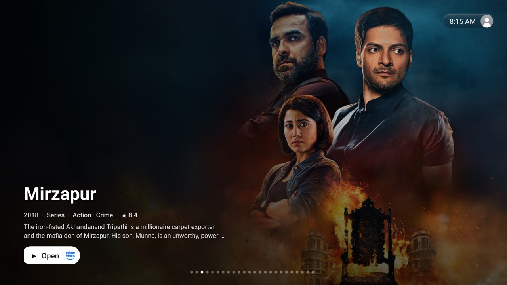
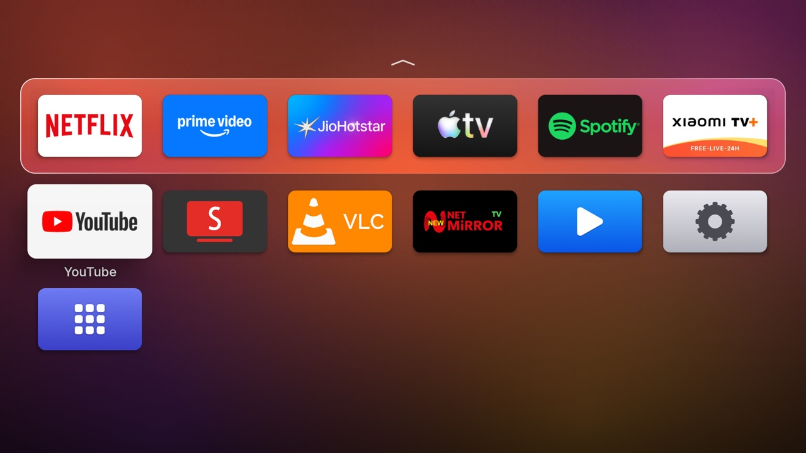
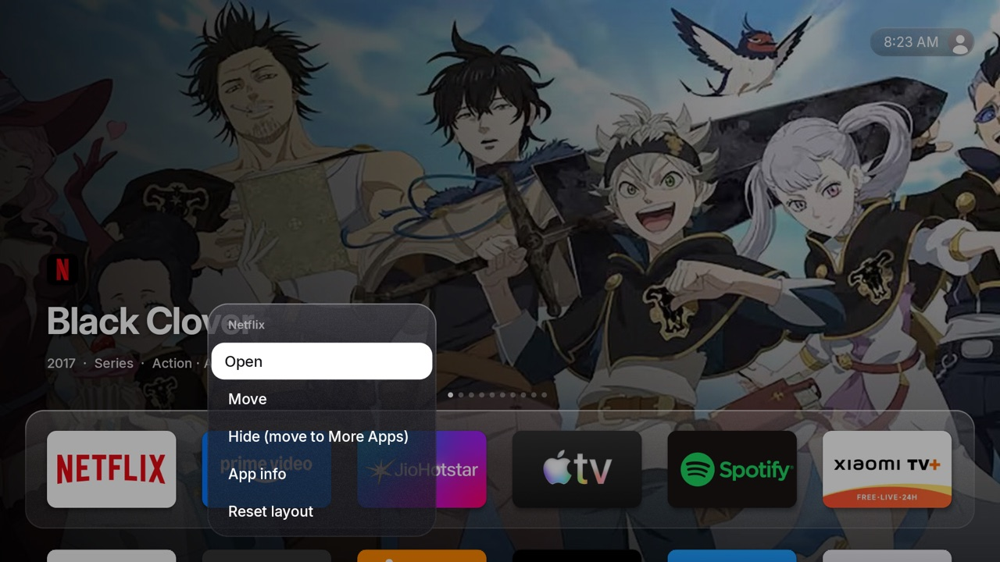

# Hume Launcher documentation

Hume Launcher (`com.petrobot.hume`) replaces the Android TV home screen with one modelled on
Apple tvOS 26. Every element was measured against Apple's own tvOS 26 screenshots and the Human
Interface Guidelines, then tuned to run at 60 fps on a low-end Mali-450 GPU.

| | |
|---|---|
|  |  |
| Home: suggestions behind the glass dock | Top shelf focused: dock slides away |
|  |  |
| Below the dock: launcher background | Options menu (hold OK on an app) |

## Contents

- **[Install and set up](install.md)** — build, install, make it the home screen, one-time
  permissions, undo.
- **[Features](features.md)** — home screen, top shelf, Continue Watching, profiles, Control
  Center, settings, remote controls.
- **[Presentation mode](presentation.md)** — sending content from a browser, the TV player,
  start on boot, and the web API.
- **[Architecture](architecture.md)** — code map, build, design decisions and performance notes.

## At a glance

| Area | What it does |
|---|---|
| Dock & grid | Frosted Liquid Glass dock; 5:3 cards, 6 per row; 1.2× focus lift; tvOS zoom-to-open |
| Top shelf | Suggestions from JustWatch (no key) or TMDB, or Continue Watching; switch with the tab bar |
| Profiles | Up to 3, unique emoji avatars; separate layout, background and history; picker on wake |
| Control Center | Sleep, Wi-Fi, Do Not Disturb, audio, sleep timer, Bluetooth, accessibility, settings, search |
| Presentation | Browser upload of images/videos/webpages, looping full-screen playback, start on boot |
| Settings | Everything in one place, opened from the gear in Control Center |
