# Features

## First-time setup

The first time Hume opens, it walks through Apple-style setup pages, one question each (OK moves on,
Back goes back):

1. **Welcome**, fading through Indian and world languages, then Get Started.
2. **Create your profile**: name and emoji avatar for the first profile.
3. **Choose a look**: this profile's background, previewed live behind the page.
4. **Your Home Screen** (per profile): Recommendations on/off and News on/off.
5. **Weather**: use my location (shows the detected city), choose a city, or don't show weather.
6. **Presentation** (whole TV): use Presentation, and if on: start with the TV  and keep screen awake — all on one page, so nothing needs configuring in Settings afterwards.
7. **Finish setting up**: Android's location prompt appears right away; make Hume the home screen
   and allow whatever else the TV supports (each ticks when done; unsupported ones are left out).
8. **You're all set** → Home.

The top-shelf choice (recommendations / news) belongs to each profile; each mix has its own cache.

Settings → Home → **Run setup again** repeats it.

| | | |
|---|---|---|
| 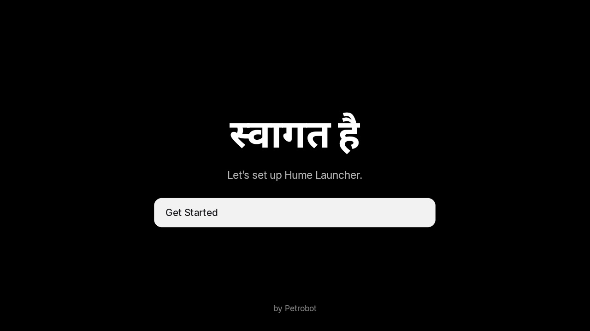 | 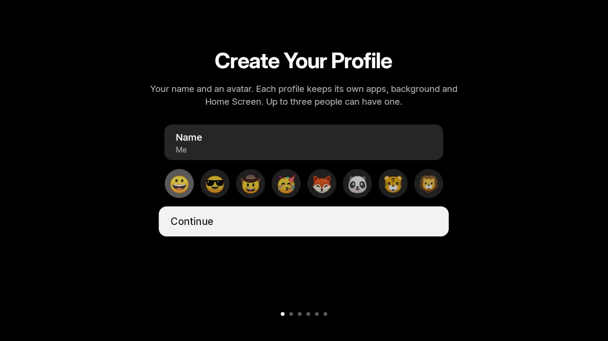 | 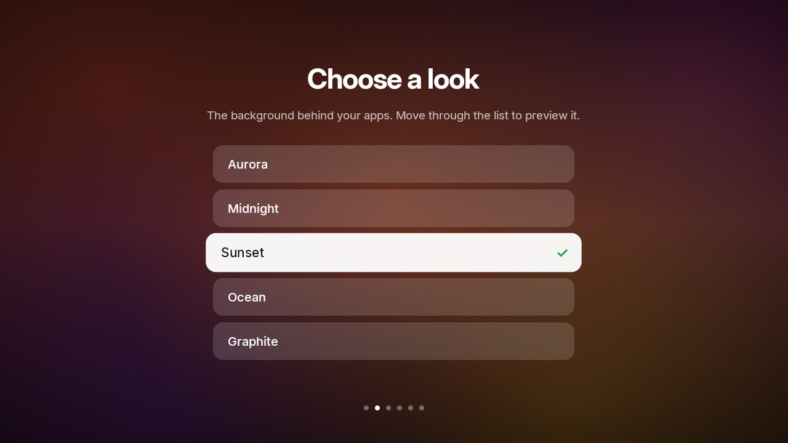 |
| 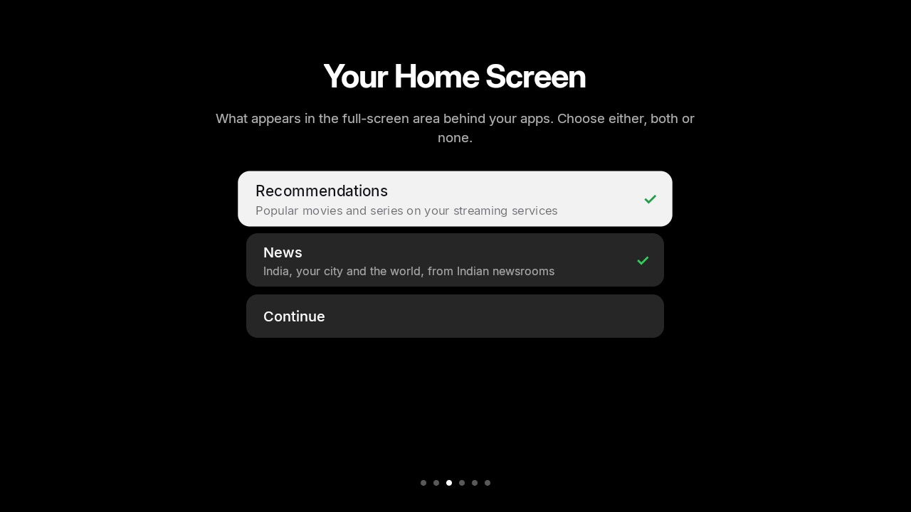 | 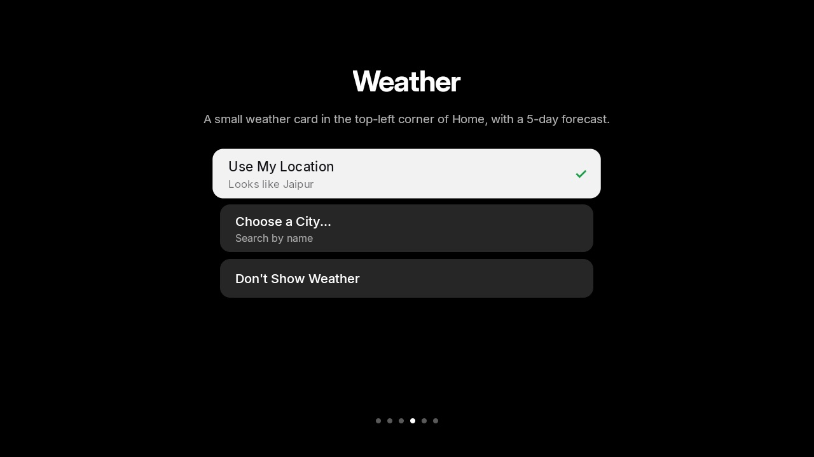 | 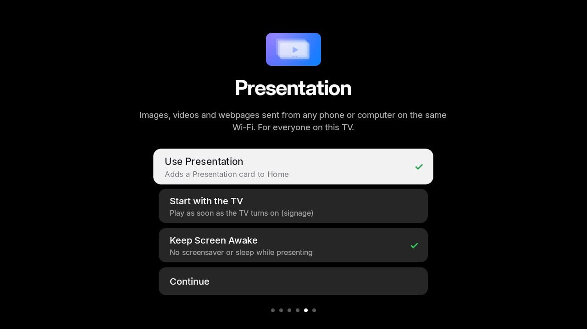 |
| 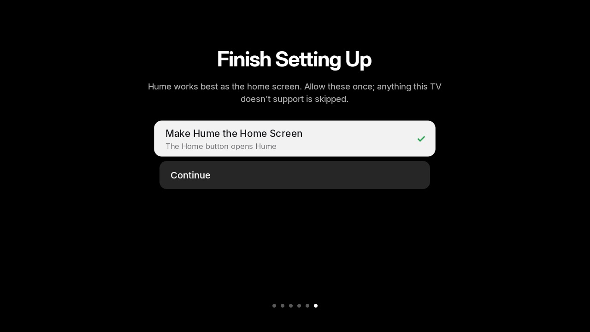 | 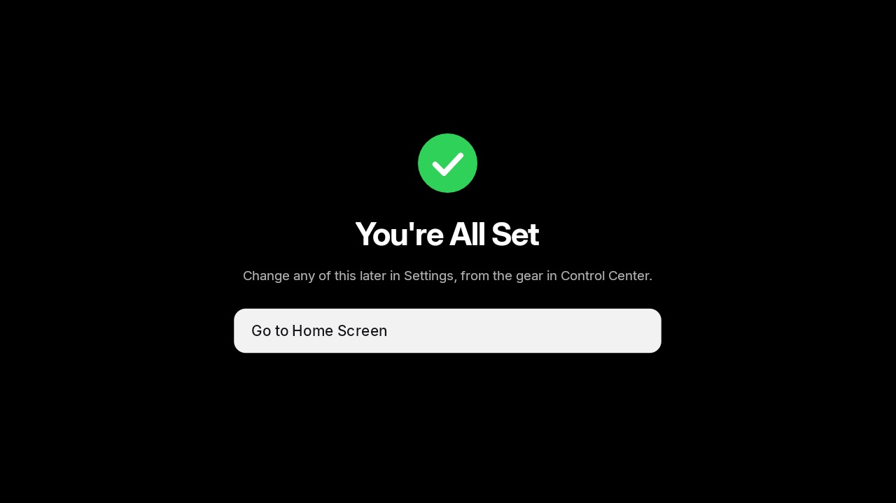 | |

## Home screen

- **Dock**: the first row of apps sits on a frosted Liquid Glass panel that shows a blurred,
  colour-boosted copy of whatever is behind it, with lensed edges and a specular rim.
- **Grid**: 6 cards per row in Apple's 5:3 shape; spacing, margins, corner radii and the dock
  position were measured from Apple's tvOS 26 screenshots and the HIG (60 pt / 80 pt safe area).
- **Focus**: the card lifts to 1.2× with a soft shadow and a single subtle glare sweep; pressing OK
  dips the card (the HIG's "pressed" state) and zooms it to full screen while the app opens.
- **Names** appear under focused cards below the dock (none inside the dock, as on tvOS).
- **More Apps**: hidden apps live in a folder card at the end of the grid.
- **System apps** (Settings, Play Store, etc.) get tvOS-style cards — a gradient with a white glyph.
- **Background**: Aurora, Midnight, Sunset, Ocean or Graphite (Settings → Background).

### Remote

| Where | Key | Action |
|---|---|---|
| Any card | OK | Open (zoom animation) |
| Any card | Hold OK / Menu | Options menu: Open, Move, Hide, App Info, Uninstall, Reset Layout |
| Move mode | Arrows / OK | Move the wiggling card / finish |
| Dock | Up | Top shelf (or the tab bar if the shelf is empty) |
| Tab bar | Left / Right | Suggestions ⇄ Continue Watching |
| Status row | Left / Right | Tab bar ⇄ Control Center ⇄ profile avatar |
| Tab bar | Left (on Suggestions) | Weather card |
| Anywhere | Home | Back to the first app in the dock |

## Status row

Top right, as on tvOS: the **internet indicator** and time on a faint dark chip (for contrast over
bright artwork), the glass **Control Center** button and the profile avatar. Glass controls adapt to what is behind them: the backdrop is desaturated and
the tint darkens over bright artwork and lightens over dark artwork, so white text stays legible. The indicator is drawn like Apple's symbols, in white
only: Wi-Fi bars lit by signal strength (unlit bars at 30%) or an Ethernet symbol when the internet
works; dimmed bars with "!" when the TV is on a network that can't reach the internet; dimmed bars
with a slash when there is no network. When the internet comes back, weather and suggestions
refresh by themselves.

## Top shelf

Settings → Top Shelf → **Show in carousel**: Recommendations & News (default), Recommendations, News
or Nothing.

- **News**: India, local (your city, from the weather location) and world stories mixed together,
  from Indian newsrooms' feeds with large images — Times of India, Hindustan Times, The Indian
  Express, India Today and News18 by default (NDTV and The Hindu optional). Headline, summary, section,
  newsroom and age; no button. Updates every 30 minutes (15/30/60 in Settings). Local news uses
  Times of India city feeds (16 cities) plus Indian Express and Hindustan Times city feeds.

Shown behind the dock while a dock app is focused; below the dock the launcher background returns.

- **Suggestions**: up to 10 titles popular in India on your services. Source: **JustWatch**
  (no key; unofficial API) or **TMDB** (free key). Full-screen artwork with the service's icon,
  title, year · type · genre · rating; when focused, the description and a **▶ Open** button that
  goes to the title's page in the app (exact title link with JustWatch; search with TMDB).
- **Continue Watching** (can be switched off per profile in Settings → Continue Watching or during
  setup; the tab bar only appears when both tabs are available): what you played recently in each app, from the "now playing" information
  apps publish (title, artwork, position). **▶ Resume** opens the app; an Up Next strip with
  progress bars appears when focused; Menu → *Remove from Continue Watching*.
- Left / Right browse with a slide animation; the carousel keeps its place when you come back.

## Inputs

On TVs with inputs (HDMI, AV, tuner), an **Inputs** card starts as the first card in the dock and an
**Inputs** button sits in Control Center. Either opens the input picker: Control Center-style capsules
for each input the TV reports (for example HDMI 1–3, AV 1–2, TV); OK switches to it through the TV
app. The card can be moved, hidden to More Apps like any app, or switched off in Settings → Inputs,
which also turns the button on or off. Boxes without inputs (such as a Mi Box) show neither.

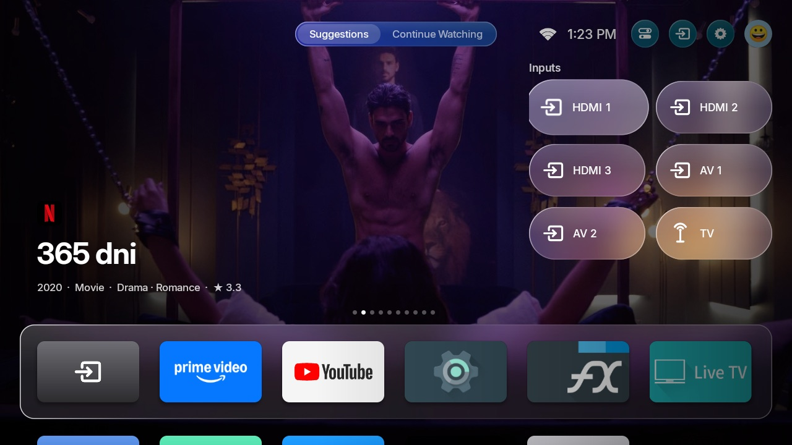

## Weather

- A small glass **weather pill** sits in the top-left corner: icon, temperature, condition, city and
  today's high/low (the 5-day forecast is in the panel it opens). It fades with the top shelf like the time.
- Press ← from the Suggestions tab to focus it; **OK** opens the forecast: current
  temperature, humidity and wind, the next six hours, and a 5-day list with temperature range bars
  (blue → red, with a dot for the current temperature), as in Apple Weather.
- Data from free services that need no key: [Open-Meteo](https://open-meteo.com) (default),
  [MET Norway](https://api.met.no) (Yr) and [wttr.in](https://wttr.in) (3 days). The chosen source
  is tried first and the others are used if it can't be reached; the forecast panel shows which
  one answered and when.
- Updates every **15 minutes** by default (10, 15, 30 or 60 in Settings), and right away when the
  internet comes back. The last forecast is cached, so it shows instantly and while offline.
- Location comes from the internet address (ipapi.co, ipwho.is or geojs.io) unless you choose a
  city in Settings.

## Navigation sounds

A soft tick on each D-pad move and a deeper tock on select, like Apple TV (synthesised on the TV, no
audio files). Settings → Home → Navigation sounds.

## Idle full-screen carousel

After 20 seconds without input on Home (Settings → Home → Full-screen carousel when idle: Off, 10,
20, 30 or 60 s), the dock and app grid slide down, the weather pill and tab bar fade, and the
carousel keeps playing full screen with its title and summary at the bottom. The first press of any
key brings the Home Screen back (that press only wakes it; focus doesn't move).

## Profiles

- Up to **3 profiles**, each with a **unique emoji** on a pastel circle.
- Each profile keeps its own **app layout and hidden apps, background, top-shelf tab and
  Continue Watching**.
- The avatar (top right) opens the switcher: a two-column popover with a green check on the
  current profile and **+ Add User**. Menu on a profile: Change Emoji, Rename, Change Colour,
  Delete.
- With two or more profiles, the switcher appears when the TV wakes (Settings → Show profiles on
  wake).

## Control Center

Opened from the button next to the time. Tiles: **Power Off** (sleep), **Wi-Fi**, **Do Not
Disturb**, **Audio**, **Sleep Timer** (Off → 15 → 30 → 60 → 90 min), and round shortcuts for
**Inputs** (TVs with inputs; Accessibility otherwise), **Bluetooth/controllers**, **Settings** and
**Search**.

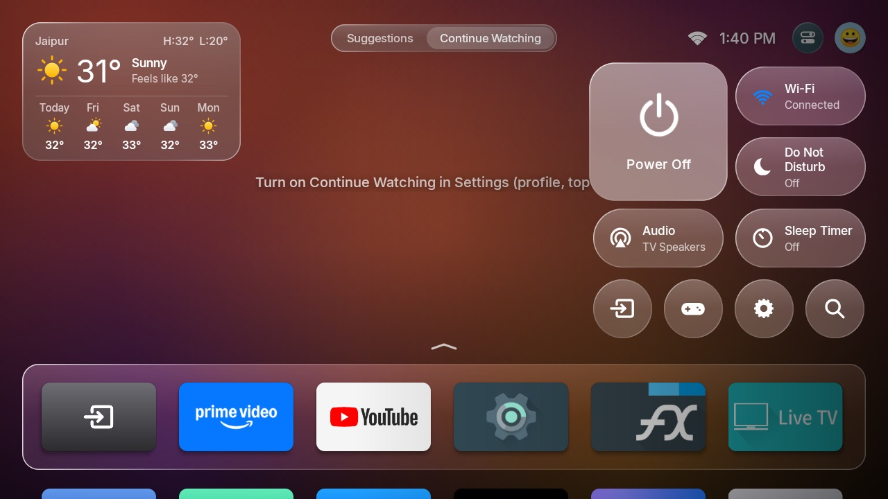

## Settings

Opened from the gear in Control Center. A main list opens a page per section (Back returns):
Profiles, Top Shelf, Presentation, Inputs, Weather, Continue Watching, Home, Permissions, About,
and the TV's own settings.

| | |
|---|---|
| 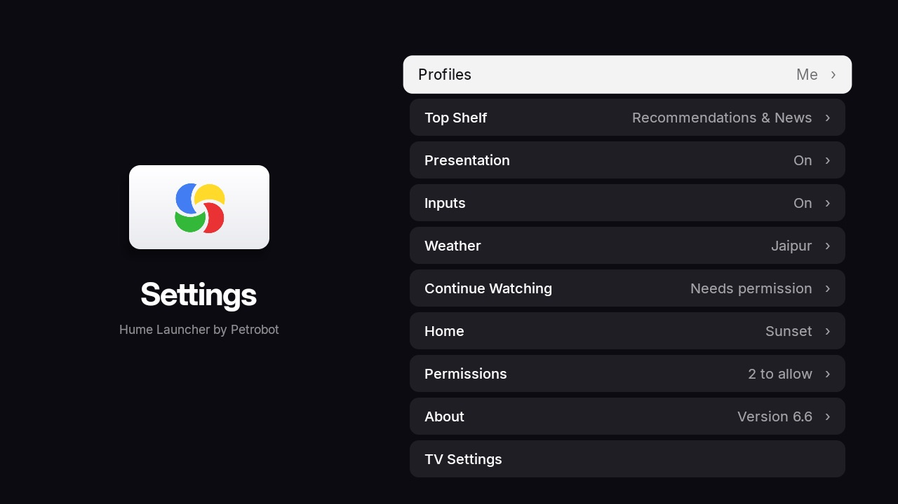 | 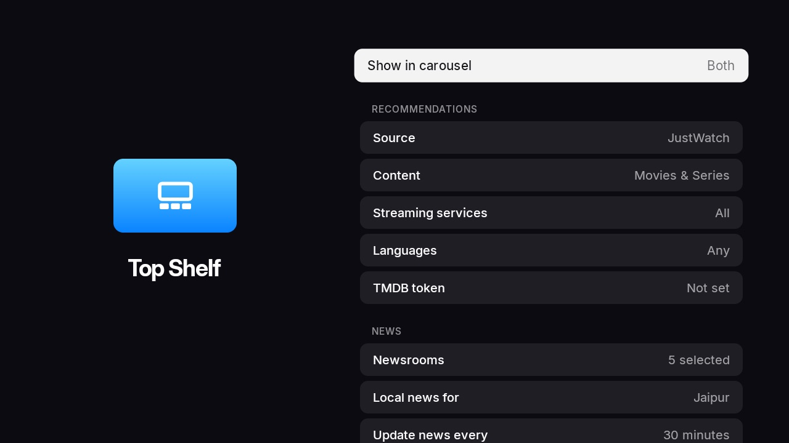 |

### Permissions

Hume asks on screen wherever the TV allows it; adb is only a last resort:

| Feature | How it is granted |
|---|---|
| Wi-Fi name (location) | Android's normal permission prompt |
| Power Off & Sleep Timer (device admin) | Android's "Activate device admin app?" screen; on TVs without device-admin support it says so |
| Continue Watching & Do Not Disturb (notification access) | The system notification-access screen; not available on low-RAM (1 GB) TVs, where Android disables it |
| Home screen | Android 10+ "default home app" prompt, the TV's Home-app settings, or Android's chooser; Hume offers this once when opened while another launcher is home |

Only when a TV has none of these screens is the one-time command shown.

## Display scaling

All sizes are expressed relative to the screen's resolution (a 960×540 design grid), so the layout
keeps its proportions on 720p, 1080p and 4K outputs and rebuilds itself if the display changes.
